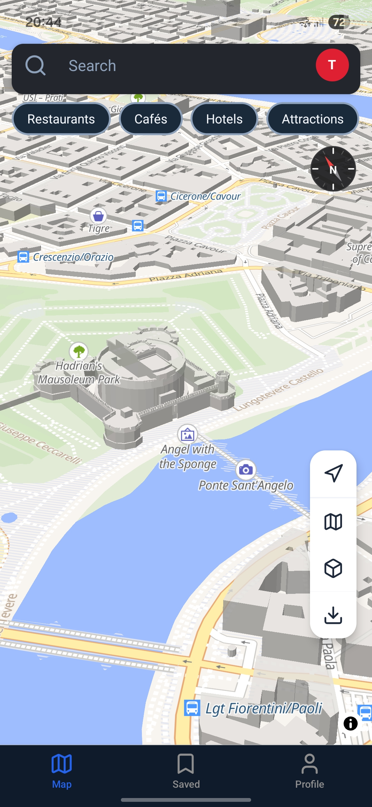

<div align="center">


# Nowhere

**Simulate your location, on your device.**

[](https://github.com/Cactus-Apps/Nowhere/releases)
[](https://github.com/Cactus-Apps/Nowhere/releases)
[](LICENSE)
[](https://nowhereapp.vercel.app)

</div>

---

## What is Nowhere?

Nowhere is a privacy-first, open-source Android app that lets you simulate your GPS position on your own device using Android's built-in mock location feature. Move freely with a joystick, follow a hand-drawn route, plan a multi-stop trip on foot or by car, or let realistic walking and driving profiles play back a route for you — all without ads, accounts, trackers.

Nowhere is built for development, testing, and entertainment. Use it to test location-based apps and features, explore map data, or just see what a different place looks like.

Map data comes from [OpenStreetMap](https://openstreetmap.org) under the ODbL license. Routing is powered by [OSRM](https://routing.openstreetmap.de). Traffic rules and speed limits come from the [Overpass API](https://overpass-api.de). No proprietary map APIs. No hidden trackers.

---

## Features

- **🎮 Free joystick mode** — Move your simulated position in any direction with an on-screen joystick, with adjustable walking and driving speeds.
- **🗺️ Route simulation** — Pick a start, a destination and as many intermediate stops as you like. Routes are calculated with OSRM and played back step by step.
- **🚶 Realistic walking profiles** — Walking, jogging and cycling speeds.
- **🚗 Driving with traffic rules** — City, country and highway speeds, optional OSM speed limits, and automatic pauses at intersections and traffic signals.
- **📍 Quick location control** — Drop a pin anywhere on the map, drag the marker, or search for a place to set your simulated position instantly.
- **⭐ Favourites & recents** — Save places and revisit recently used locations.
- **🔄 Continuous simulation** — Your simulated position stays active while you move between screens, so other apps never fall back to your real location mid-session.
- **🌍 Map styles** — Multiple dark and light map styles.
- **📶 Background simulation** — Keeps the simulation running while the app is in the background.
- **🌐 3 languages** — English, German and Spanish.
- **🛡️ Zero tracking** — No account, no analytics, no advertising, no data collection.
- **💻 100% open source** — Read every line of code on GitHub.

---

## Screenshots

| Home                                                        | Route simulation                                            | Driving                                                     |
| ----------------------------------------------------------- | ----------------------------------------------------------- | ----------------------------------------------------------- |
|  |  |  |

---

## Installation

### Android

1. Go to [Releases](https://github.com/Cactus-Apps/Nowhere/releases) and download the latest `.apk` file.
2. Open the file in your file manager.
3. If prompted about installing from an unknown source, tap **Allow**.
4. Tap **Install**.

### iOS

Not available yet.

### Important: enable the mock location app

For Nowhere to work, you must select it as the mock location app in your device's developer options:

1. Enable **Developer options** on your device (tap **Build number** seven times in **About phone**).
2. Open **Developer options**.
3. Under **Select mock location app**, choose **Nowhere**.

Without this step, the app can display positions but other apps will not receive the simulated location. Expo Go is not supported — the app needs a native build.

---

## Getting Started (Development)

### Prerequisites

- Node.js 18 or later
- npm
- Android Studio (for Android builds)
- A physical Android device (recommended) — mock location requires a real device or emulator with the mock location app set

### Setup

```bash
git clone https://github.com/Cactus-Apps/Nowhere.git
cd Nowhere
npm install
npx expo start
```

Because Nowhere includes a custom native module for mock location, you need a development build (not Expo Go):

```bash
npx expo run:android
```

See [CONTRIBUTING.md](CONTRIBUTING.md) for the full development guide.

---

## Contributing

Contributions are very welcome — especially in these areas:

- **UI / UX improvements** — better flows, cleaner layouts, accessibility
- **Translations** — new languages via the `locales/` folder (currently English, German, Spanish)
- **Bug fixes** — pick an open issue and send a PR
- **Map data** — editing [OpenStreetMap](https://openstreetmap.org) directly benefits Nowhere and every OSM-based app

If you have an idea or found a bug, open an [Issue](https://github.com/Cactus-Apps/Nowhere/issues).
For security vulnerabilities, please email **cactus_apps@proton.me** instead of opening a public issue.

→ Read the full [CONTRIBUTING.md](CONTRIBUTING.md)

---

## Tech Stack

| Layer              | Technology                                 |
| ------------------ | ------------------------------------------ |
| Framework          | React Native + Expo                        |
| Navigation         | expo-router (file-based)                   |
| Maps               | MapLibre + OpenFreeMap / bundled styles    |
| Routing            | OSRM (routing.openstreetmap.de)            |
| Reverse geocoding  | Nominatim (OpenStreetMap Foundation)       |
| Traffic rules      | Overpass API (signals & speed limits)      |
| Mock location      | Custom native Android module + Expo plugin |
| Background service | expo-location + expo-task-manager          |
| Persistence        | AsyncStorage                               |
| Animations         | react-native-reanimated + gesture-handler  |
| State              | Custom store (useSyncExternalStore)        |
| Icons              | lucide-react-native                        |
| Translations       | i18next (en, de, es)                       |

---

## Privacy

Nowhere collects as little data as possible. Your location stays on your device. There is no account, no analytics and no advertising. Requests for routing, geocoding, traffic rules and map tiles go directly from your device to the third-party services listed above — we never receive or process them.

→ Read the full [Privacy Policy](https://nowhereapp.vercel.app)

---

## Links

- Website: [nowhereapp.vercel.app](https://nowhereapp.vercel.app)
- Contact: [cactus_apps@proton.me](mailto:cactus_apps@proton.me)

---

## License

This project is licensed under the **GNU General Public License v3.0 (GPLv3)**.

Everyone is free to use, modify, and distribute the code — but any derivative work must also be released under GPLv3.

See [LICENSE](LICENSE) for the full license text.

<div align="center">
  <sub>Made with ❤️ by <a href="https://github.com/Cactus-Apps">Cactus Apps</a></sub>
</div>
